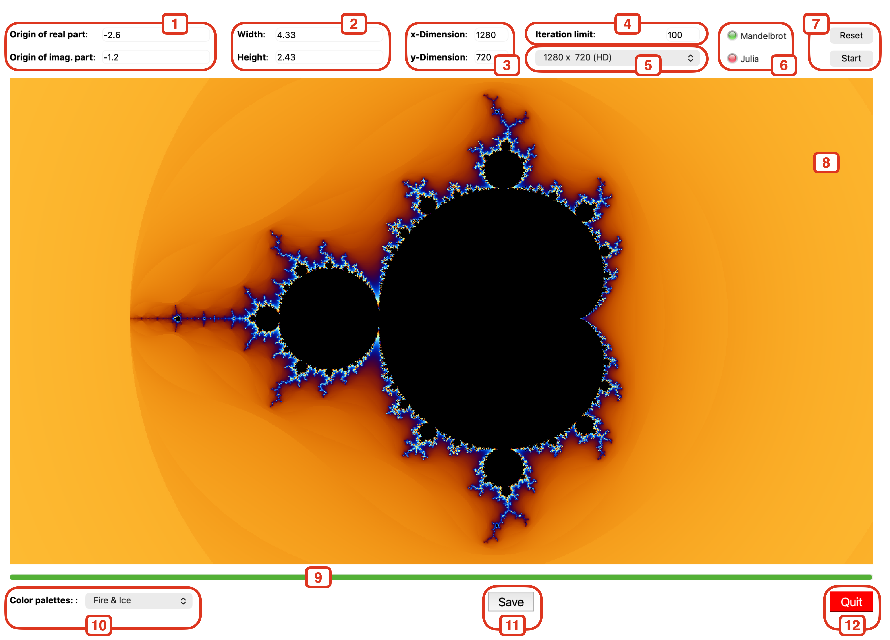
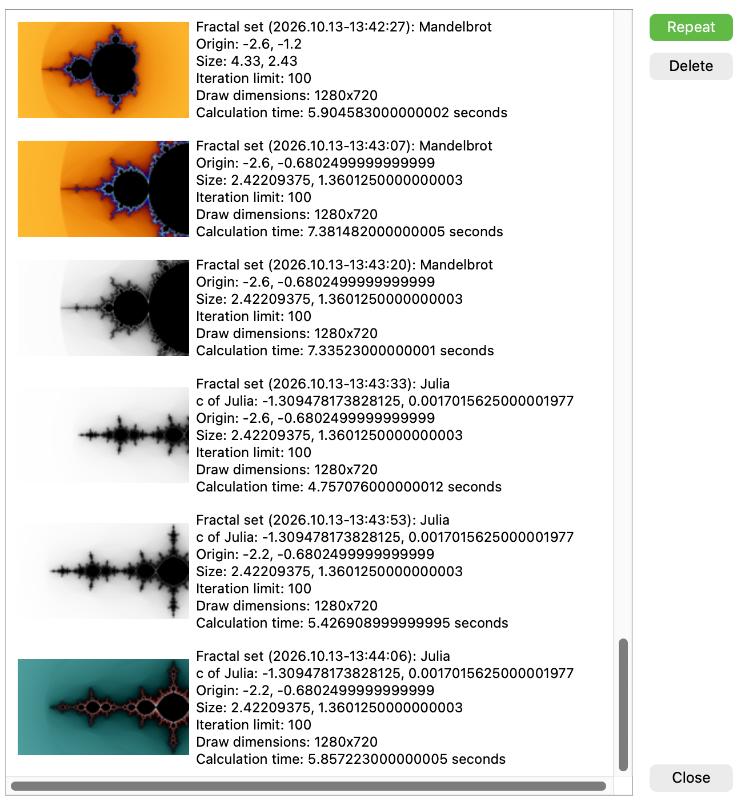
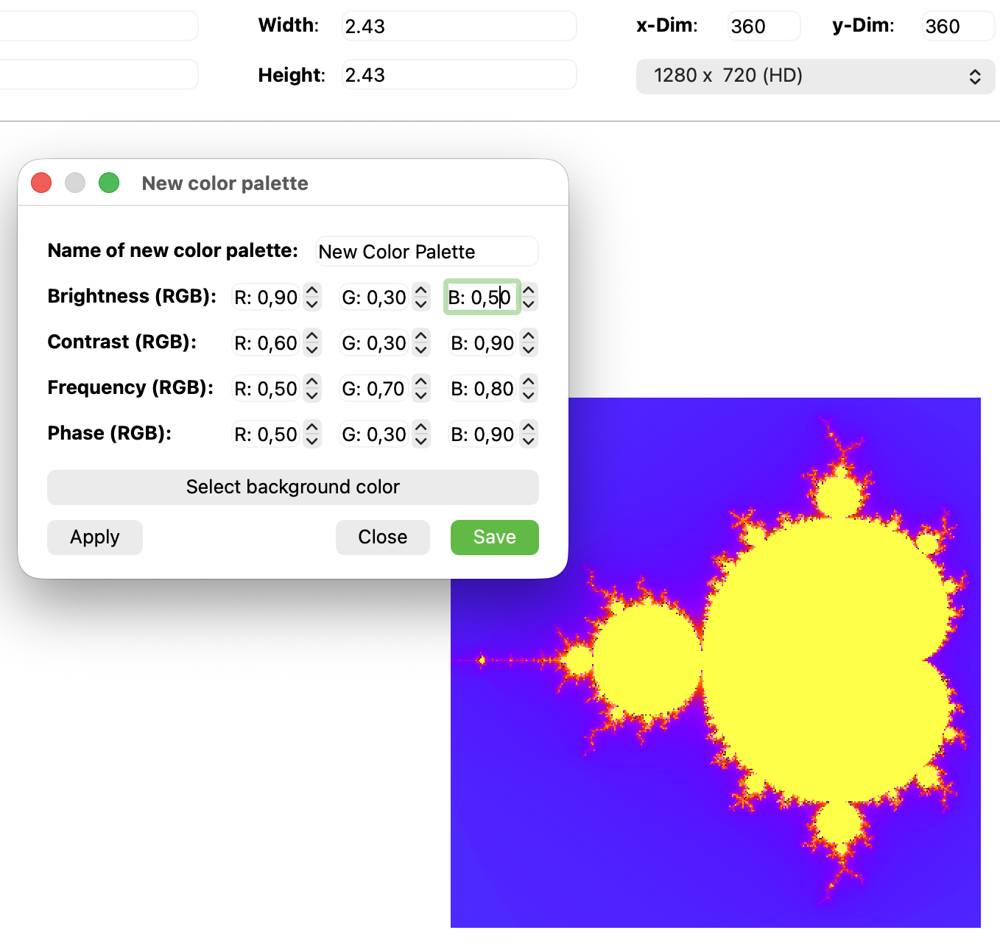
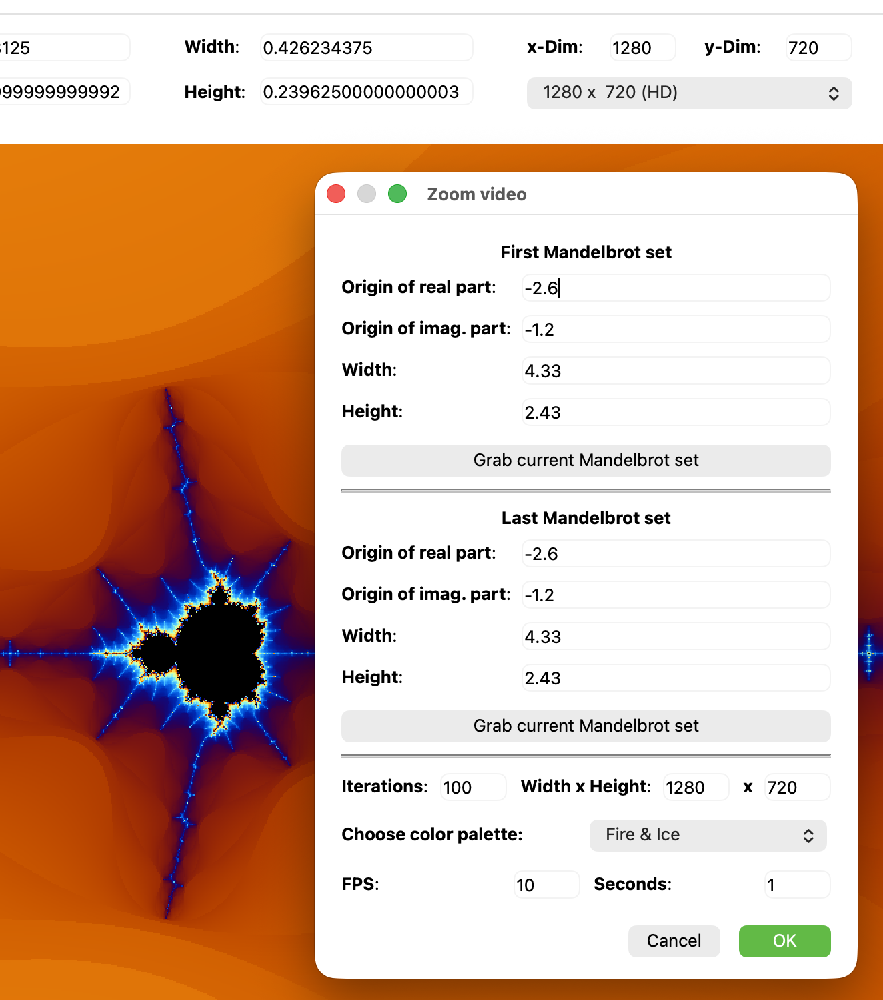

# qtFractals
App to calculate fractals with Python &amp; Qt (PySide6)

## Introduction
This app calculates fractal sets. It provides a few features like

- "zoom-in" in a fractal via cursor,
- "zoom-in" / "zoom-out" via specific input coordinates,
- define the area of the calculated set,
- define the value of iteration for the fractal formula,
- history: every fractal calculation will be stored
- providing pre-defined drawing dimensions,
- switching from Mandelbrot set to Julia set,
- saving the calculated result in a file,
- change the color palette (providing pre-defined color palettes)
- ...

The app is written in Python3 and PySide6.

This program is free software: you can redistribute it and/or modify
it under the terms of the
[Apache 2.0 license](http://www.apache.org/licenses/LICENSE-2.0) as
published.

## Main window

In this section I describe the main window and its controls:

<!--  -->

1.  **Origin coordinates of the complex area** separated by the real part
    and complex part.
2.  **Width and height of the complex area**
3.  **Width and height of the drawing area (resolution)**. Additionally to the
    manual input you may select a few predefined resolutions. Relevant for the
    next calculation are the values in the input/edit fields. Take care that
    the ratio of the complex area and the drawing area have the same value!
    (Tip: defining areas to zoom in with the cursor takes into account the
    ratio by default.)
4.  **Itration limit** for the fractal formula. Good values are from 100 to
    1000. The bigger the value, the time consuming the calculation (more
    detailled results).
5. **Color palettes** provides a few predefined color palettes. As soon as
   you change the current color palette the current fractal set will be
   recalculated with the new selected colours.
6.  **Fractal indicator** that shows what kind of set (Mandelbrot or Julia)
    currently is active.
7.  **"Reset" and "Start" button**: The "Reset" button resets all values to
    the values at the initial phase of the app. The "Start" button starts a
    new calculation with the values in (1), (2), (3), (4), and (5).
8.  **The drawing area**
9.  **The progress bar** indicates how much of the fractal has been calculated.
    The fractal set will be shown at the end of the progrss bar.
10. **Status bar**, which show progress in percentage and consumed process time
    to calculate the fractal set.

## History window

<!--  -->

The history window shows all past calculations since starting the app the first
time. The entries are sorted by time. You can delete single entries (at the moment
one by one only) or repeat a specific calculation. The repeated one generates a
new history entry!

## New color palette window

<!--  -->

With this window you may define a new color palette. At the top of the window you
may provide a name for the new color palette. Pressing "Apply" shows a small
Mandelbrot fractal set with new parameters as a preview. Pressing "Save" saves
the new defined color palette by re-calculating a default Mandelbrot fractal set
and adding it to the history list. Pressing "Close" closes the window.

For the theoretical background of this specific color palette calculation and the
meaning of these parameters you may follow these two links (the mastermind of this
is [Inigo Quilez](https://iquilezles.org/)):

- [Procedural Color Palette](https://iquilezles.org/articles/palettes/)
- [A simple formula to create beautiful color palettes](https://www.youtube.com/shorts/TH3OTy5fTog)

**Attention**:
User defined color palettes are stored in the history list only. If you delete the
specific history item the user defined color palette will be lost!

## Create a zoom video

<!--  -->

To build a zoom video you have to provide the parameters of two Mandelbrot fractal
sets: starting point and ending point. You may provide the data manually or grab it
from the current Mandelbrot fractal set (preferred method). Additionally you may
select the resolution (width and height), frames per second, and duration (seconds)
of the video.

Of course you are able to select an existing color palette from a list.

At the end of the rendering process (a progress window will be shown) you may select
the directory the video will be stored. It replaces an existing file!

**Attention**:

- Take care, that the fractal set ratio (width x height) is the same as the ratio of
  the resolution (width x height)!
- During the calculation temporary a lot of video frames (FPS x Seconds) will be generated.
  So take care to have enough disk space.

## Mouse and keyboard actions

### Julia set

You may switch from the Mandelbrot set to the Julia set by pressing [CTRL]+LMB
(Windows/Linux) or [Cmd(⌘)]+LMB (Apple) on any point of the calculated set.
Immediatly the calculation starts for the Julia set at this point. Of course
you may zoom-in in the Julia set, too. The fractal indicator (see item 5 above)
switches accordingly.

### Menu actions

- [CTRL]+[M] (Windows/Linux) or [Cmd(⌘)]+[N] (Apple): Show "Zoom video" window
- [CTRL]+[N] (Windows/Linux) or [Cmd(⌘)]+[N] (Apple): Show "New color palette" window
- [CTRL]+[Q] (Windows/Linux) or [Cmd(⌘)]+[Q] (Apple): Quit the application
- [CTRL]+[S] (Windows/Linux) or [Cmd(⌘)]+[S] (Apple): Save the current image
- [CTRL]+[T] (Windows/Linux) or [Cmd(⌘)]+[T] (Apple): Show the "History" window

### Stop running calculation

To stop a (long) running calculation you may press the key [ESC] or the RMB.

### Zoom-in

By pressing the LMB only you may draw an rectangle with the cursor (based on the
current ratio, see item 3) which defines the area you want to zoom in. As soon
as the calculation starts (immediately after release of the LMB), the new values
(see item 1 and 2 above) will be adapted accordingly.

## Development recommendations

### Resources

To iclude all necessary resources you need the Qt resource system (`.qrc`)
provided by PySide6 from Qt: "pyside6-rcc" (included already in the "pyside6"
package):

`pyside6-rcc resources.qrc -o resources_rc.py`

This file contains all "styles" as text and the images as binary code.

### Build

To build a standalone app you need "pyinstaller". You have to install it first:

`pip install pyinstaller`

In the next step you have to change in the directory where "main.py" is and
execute the following line in a terminal:

macOS:\
`pyinstaller --noconsole --onefile --icon=ui/Mandelbrot.icns main.py`

Windows 11:\
`pyinstaller --noconsole --onefile --icon=ui/Mandelbrot.ico main.py`

## Forthcoming features

These are the addional features for the future (arbitrary order):

- Create an animation (sequence of images) by defining start point and end point
  via zoom-in.
- Provide the ability to change the current default theme.
- ...